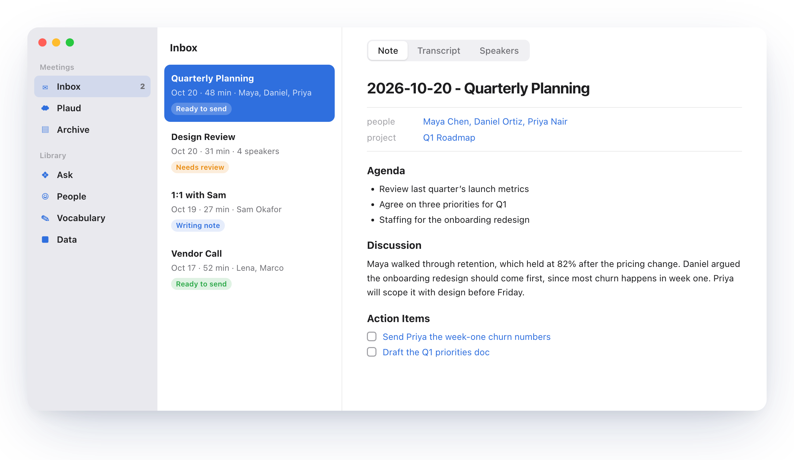

# Boswell

Boswell is offline meeting transcription with speaker diarization and voice profile matching, built for Apple Silicon. Audio, transcripts, and voice profiles never leave the machine.

<picture>
  <source media="(prefers-color-scheme: dark)" srcset="assets/screenshot-dark.png">
  
</picture>

## Pipeline

1. **Normalize** to 16 kHz mono WAV with ffmpeg. Near-silent channels in stereo files are dropped instead of mixed in.
2. **Diarize** with pyannote `speaker-diarization-community-1` on the GPU (MPS), with 2 to 8 speakers by default.
3. **Transcribe** with mlx-whisper `large-v3-turbo`, only inside the speech regions found by diarization. This stops Whisper from inventing text during silence.
4. **Merge** word timestamps with speaker turns. Short fragments at turn edges are folded into the surrounding sentence or turn.
5. **Match** each speaker's embedding against enrolled profiles by cosine similarity. A name is assigned at 0.6 or above, otherwise the speaker is marked unknown and a review file is written.
6. **Render** a markdown transcript with frontmatter (title, date, attendees, source file).

On a 30 minute meeting the whole run takes about 2 to 3 minutes on an M3 Max. mlx-whisper ran 5 to 6x faster than faster-whisper (CPU only on macOS) with near identical output, so it is the default.

## Setup

```
uv sync
uv run make_app.py
```

Then open Boswell. The first time, a short setup asks for your name, a Hugging Face token for the speaker detection model, then downloads the two models it transcribes with (Whisper, 1.6 GB, and pyannote's speaker detection, 34 MB) in the background with progress, what writes notes (a model on the Mac or Claude), your Obsidian meeting notes folder and your to-do app. Only your name is required, and all of it is in Settings afterwards (**Run Setup Again** is under About). For the token, accept the model terms at https://hf.co/pyannote/speaker-diarization-community-1 and create a read token with the same account. It's kept in the Keychain and only used to download the model once. Settings has the same model list and Download button under Models, and a model not downloaded beforehand still downloads the first time it's needed.

`.env` is optional. The app reads the one in the library folder (`~/Library/Application Support/Boswell/.env`), and scripts run from the project folder read the project's `.env` too. Values there (see `.env.example`) still work as a fallback, and anyone with `MIC_OWNER` set there skips the setup. To download and test the models from the command line instead:

```
uv run scripts/check_setup.py   # downloads and tests the models
uv run scripts/check_setup.py --offline
```

After the offline check passes, you can add `HF_HUB_OFFLINE=1` to `.env` so nothing reaches Hugging Face again.

## App

Boswell is a Mac app, in `mac/`, written in SwiftUI. All the transcription, naming and note logic is in Python, in a server the app starts in the background and stops when you quit. Build it with your own icon (any square PNG, 1024x1024 is best):

```
uv run make_app.py --icon ~/Pictures/my-icon.png
```

It goes in `/Applications/Boswell.app`, or is rebuilt wherever you moved it. The app doesn't need the project folder to run. The server's code is copied into the app along with [uv](https://docs.astral.sh/uv/), and with ffmpeg and ffprobe, built from source by `scripts/build_ffmpeg.py` (once, in under a minute, cached after). That build is the pinned ffmpeg release, checked against its checksum, configured with nothing GPL or nonfree, so it's LGPL 2.1, and with only what Boswell needs: decoders for the audio it takes, output to WAV and raw PCM, local files only. The app carries the license and a note of how it was built in `Contents/Resources/licenses/ffmpeg`, and puts its own ffmpeg first on the server's PATH, so Homebrew's isn't needed. The first time the app opens, uv downloads its own Python 3.11 and the server's packages, exactly as `uv.lock` has them (about 1.5 GB), into `~/Library/Application Support/Boswell/env`, with progress on screen. It does this again only when an update changes `uv.lock`, and only for what changed. uv keeps its usual download cache, so on a Mac that already has the packages it takes seconds. The first build also copies the project's `.env` into the library folder. Run it again after changing the code or the icon, since the app runs its own copy of the code. Under `swift run`, the app uses the project folder and its `.venv` instead. Without `--icon` it uses `assets/icon.png`. It needs Xcode, since SwiftUI's macros don't ship with the Command Line Tools, and is signed with your Apple Development certificate when Xcode has made one, so macOS remembers that it may use the Documents folder across rebuilds. Without one it falls back to an ad hoc signature, and macOS asks again after every rebuild. The server's log is `~/Library/Logs/Boswell.log`.

For development, `uv run app.py` runs the server on its own at http://127.0.0.1:8765 (the app uses it when it's already running), and `cd mac && DEVELOPER_DIR=/Applications/Xcode.app/Contents/Developer swift run` runs the app. Set `BOSWELL_URL` to point the app at a server on another port, `BOSWELL_PAGE` (such as `vocabulary`) to open on a page, `BOSWELL_MEETING` to select a meeting by its id, and `BOSWELL_SNAPSHOT=/path/to/file.png` to save a picture of the window a few seconds after launch, which checks a layout without needing screen recording access.

The flow: drop a recording on the window or import one from Plaud, it is transcribed, you confirm speakers if asked, the note is written automatically with `SUMMARY_BACKEND` once every speaker is named, then you review and send it. Cmd+1 to Cmd+8 switch pages.

- **Inbox:** drop m4a, mp3 or wav recordings on the window, or press Cmd+O, to queue them. One file runs at a time, with live progress in the sidebar. Dropped files are copied into the library's `data/` folder (see [The library folder](#the-library-folder)), and the source (Plaud or a split Zoom call) is detected. A file that was already processed is skipped, because re-running replaces its confirmed names. Each meeting shows where it is: needs review, writing note, ready to send or no note yet. Right-click to rename, show it in Finder or open it in Obsidian. The Dock icon shows how many meetings need review.
- **Archive:** sent meetings, searchable, with a filter for meetings with to-dos sent or not yet checked. **Move to Inbox** on the right-click menu brings one back. Meetings imported from Obsidian open as their note, read only.
- **Plaud:** recordings uploaded to Plaud in the last 14 days. Import downloads the audio with the Plaud CLI (`npm install -g @plaud-ai/cli`, then Sign In in Settings) and runs it here like a dropped file, so Plaud doesn't need to transcribe it. Recordings already in the app show as such, and open their meeting. Right-click one to hide it, for a meeting already in the app from another recording, and Show Hidden in the toolbar brings hidden ones back. The page only appears when the Plaud CLI is installed, and Settings can turn it off.
- **Speakers:** each unknown speaker gets a few short clips with what they said, suggested names with scores, and a name field that suggests existing people or creates a new one. You can also mark a speaker as the same person as another speaker (diarization split them), leave a speaker unnamed, or name them without adding the voice to their profile. Identified speakers are collapsed, with a "Wrong?" link. Nothing is saved until you press Save Names (Cmd+Return).
- **Transcript:** play any turn, filter the transcript, copy it as markdown, or show the file in Finder. A link to a moment, from an answer or a to-do, opens the transcript on that turn.
- **Note:** the meeting note (see below), with its project. The toggle beside the project switches between the note formatted (frontmatter as properties, headings, lists, the transcript in its own box, working links) and its markdown, with a slider for the text size (Cmd+= and Cmd+- too). In the markdown, click into it to edit, and it saves as you type (Cmd+S saves at once). The inspector has two tabs. **Changes** shows a git style diff with changed words highlighted, compared with the note before your first edit (kept as `note_original.md`), or with the Obsidian copy once sent. **To-dos** is Find my to-dos. The More menu can rewrite the note, discard your edits, copy the note or show it in Finder.
- **Find my to-dos:** Claude reads the transcript for tasks you were asked to do or took on, help you offered that the others took up, and follow-ups they clearly expect from you (like answering an invitation to meet again), leaving out other people's tasks and ideas nobody took on. Borderline ones are included with the reason in their notes, since you check each one before it's added. You check and adjust them (project, when, deadline), and once added, they appear in the note as an Action Items section of links to the to-dos in your to-do app (`things:///show?id=…` for Things), so that's where they get ticked off. A sent note's Obsidian copy is updated too when it hasn't been edited there since. Every to-do sent, from a note or from Ask, is recorded against its meeting: the Inbox and Archive show how many each meeting sent (or "no to-dos" when it was checked and none were sent), and the To-dos tab lists what was sent. Looking again leaves out the ones already sent. Sending a note whose meeting was never checked first asks whether to find them, with "Don't ask again" in the dialog and a switch for it in Settings. Each to-do's note links back to the meeting with a `boswell://` link that opens it in the app, at the moment it came from.
- **Send to Obsidian:** after you review the note, copies it into your meeting notes folder (chosen in Settings, or `MEETING_NOTES_DIR` in `.env`) as `<date> - <heading>.md` and moves the meeting to the Archive. An existing file with that name is only replaced after a second click. The meeting's folder in `outputs/` is renamed to the same name, so it matches what you see in Obsidian. The recording in `data/` is renamed to match too, and the playback WAVs are deleted to save space (about 115 MB an hour, three times that for split Zoom calls). They are rebuilt from the recording in a second or two whenever you play an archived meeting, and cleared again the next time the app starts. Dropping the recording in again under its old name is still recognized.
- **Without Obsidian:** with no meeting notes folder chosen, the button is **Mark Done** instead. It moves the meeting to the Archive the same way, renaming the recording and dropping the playback WAVs, without copying the note anywhere, and the Obsidian buttons are hidden. **Export Note…** in the More menu saves any note as a Markdown file wherever you like. A meeting marked done can still be sent once a folder is chosen.

Once sent, the Obsidian copy is the master copy. Opening a sent note in the app loads the Obsidian version if it changed there. If you also edited it in the app, nothing is overwritten: the note says it changed in both places, **Show changes** compares the app copy with Obsidian, and you choose **Use Obsidian version** or **Send again**. Send again over a note you edited in Obsidian asks before replacing it. The app keeps what it last sent as `note_sent.md` to tell which side changed. A note's `transcript` property is a `boswell://meeting?id=…&tab=transcript` link, so clicking it in Obsidian opens the meeting's transcript in the app (or in the iPhone app, on the phone). The transcript file itself is in `outputs/`, outside the vault, where Obsidian can't open it. The meeting's project follows the Obsidian copy too: a project set, changed or cleared in the note's frontmatter there is what the app files the meeting under. Renaming a sent meeting and sending it again renames its note in Obsidian rather than leaving the old file behind, and links to the old name anywhere in the vault are updated to the new one, as Obsidian does when you rename a note inside it. **Move to Inbox** in the Archive brings a meeting back.

- **Ask:** questions about past meetings, such as "what did Daniel and I agree to last time?", answered by Claude (an Anthropic API key, see below). It looks meetings up by person, project, title and date, reads their notes and transcripts, and searches every transcript, then answers with links to the meetings and the moments it used. The notes and transcript excerpts it reads go to the Anthropic API. Audio and voice profiles never do. Each conversation is saved in the library and named by Claude after its first answer. They're listed in the middle column (Cmd+N for a new one, right-click to rename or delete). Return asks and Shift+Return starts a new line. Under each answer, **Send to** your to-do app picks out the actions assigned to you as to-dos, filed under one of your projects. In Things that's an open project in the areas named by `THINGS_AREAS` in `.env` (Work Projects and Work General by default), and the meeting's project charter in the project index wins when its `things project` property links one. Otherwise Claude picks the best fit, else it goes to the inbox. You check and adjust them, then they're added with a note linking back to the meeting.
- **Data:** totals for meetings, hours, people and voices, your share of talk time, meetings per month and by weekday, and the people, teams and projects you meet with most. A person opens in People.
- **People:** everyone in the library, searchable and sortable, with their organizations, teams, voice profile and meetings. Double-click a meeting to open it. Edit (Cmd+E) changes the name, organizations and teams. Organizations and teams are read from and saved to each person's Obsidian note. Edits rewrite every past transcript and note they appear in.
- **Vocabulary:** terms Whisper should spell your way (see Custom vocabulary below), with a meter for how much of the spelling hint they use. Edit a term or its "also heard as" spellings in place, and they save as you type.
- **Settings:** accent color, to-dos (the to-do app, and whether sending asks to find to-dos first, see below), Obsidian (the meeting notes and people folders, which win over the ones in `.env`, and opening a note in Obsidian as soon as it's sent), Plaud (on or off, which hides the Plaud page, and signing in or out of your Plaud account, in the browser), the Anthropic API key, the Claude model, usage, and where the project folder and log are.

**To-do apps.** To-dos go to one app at a time, picked in Settings, and work the same way in each:

- **Things 3** (the default when it's installed): a start date and a deadline, in an open project of the `THINGS_AREAS` areas. The first time, macOS asks to let Boswell control Things.
- **Todoist**: needs an API token from Todoist's Settings, Integrations, Developer, saved in the Keychain from Settings (or `TODOIST_API_TOKEN` in `.env`). Projects are grouped under their parent. Todoist has no start date, so the date becomes the due date and the deadline Todoist's deadline.
- **Reminders**: lists stand in for projects, grouped by account, and to-dos with no list go to the default list. The deadline becomes the due date, or the date when there's no deadline, and a to-do with both is reminded at 9 on its date. The first time, macOS asks to let Boswell control Reminders.
- **None** hides the To-dos tab, sending to-dos and the to-do badges.

Switching apps leaves to-dos already sent where they are, and their links still open them in the app they went to.

Links to the old web version in to-dos already in Things (`http://127.0.0.1:8765/#/transcript/…`) still work while the app is open: the server answers them with a page that hands the meeting to the app.

The server listens on 127.0.0.1 only and loads nothing from the internet.

## The library folder

Recordings, meeting folders, the database, settings and note templates live in `~/Library/Application Support/Boswell`, in a `data/` folder (recordings and the rest) and an `outputs/` folder (one per meeting). Settings shows where under About. Set `BOSWELL_HOME` in `.env` to keep it somewhere else. Earlier versions kept `data/` and `outputs/` in the project folder. The first time this version starts, they're moved into the library folder, which on the same disk is an instant rename. Each meeting's recording path is rewritten to be relative to the library, so the library can move again later. If the library folder already has either one, nothing is moved.

## Command line

File names like `2026-10-14 - Manager Check-In.mp3` give the transcript its date and title. Scripts that take a meeting take its folder or just its name.

```
uv run scripts/transcribe.py ~/Downloads/"2026-10-14 - Manager Check-In.mp3" --source plaud
```

Outputs go to `outputs/<recording name>/` in the library folder:

| File | Contents |
|---|---|
| `transcript.md` | speaker labeled transcript with frontmatter |
| `segments.json` | speaker, name, start, end, text |
| `review.csv` | written when any speaker is unknown |
| `speakers.csv` | match scores per speaker |
| `words.csv`, `turns.csv` | word timestamps and diarization turns |

### Split mode for Audio Hijack recordings

Audio Hijack writes your mic to the left channel and the Zoom app to the right. When a stereo file's two channels are unrelated (correlation under 0.2), the pipeline switches to split mode on its own:

- the mic channel is transcribed and labeled with `MIC_OWNER` from `.env`, with no voice matching needed
- diarization and matching run on the call channel only, and your profile is left out of the candidates
- if the mic channel yields fewer than 5 words, you are treated as absent

Set `MIC_CHANNEL=right` in `.env` if your setup is reversed, or pass `--split off` to treat a file as a single mix.

### Naming speakers

Either fill in the `name` column of `review.csv` and run:

```
uv run scripts/confirm.py "2026-10-14 - Manager Check-In"
```

or name speakers directly:

```
uv run scripts/confirm.py "2026-10-14 - Manager Check-In" SPEAKER_01=Alex SPEAKER_00=Priya
```

Confirming re-renders the transcript and adds that speaker's voice from this meeting to their profile. Use `--no-enroll` to rename without touching profiles, or `--skip SPEAKER_00` to leave a speaker unnamed (for example a video playing on someone's side). Confirming the same speaker again replaces the entry it added before.

### Enrolling from a clip

```
uv run scripts/enroll.py ~/Desktop/priya_sample.wav "Priya"
uv run scripts/enroll.py ~/Desktop/meeting.mp3 "Priya" --start 5:20 --end 6:10 --source plaud
```

The clip should contain only that person. 20 seconds or more works best.

### Managing profiles

```
uv run scripts/manage_profiles.py list
uv run scripts/manage_profiles.py show "Priya"              # entries with similarity to the mean
uv run scripts/manage_profiles.py rename "Katherine" "Kathryn"  # updates every past transcript
uv run scripts/manage_profiles.py merge "Pri" "Priya"       # fold the first person into the second
uv run scripts/manage_profiles.py remove-entry <id>
uv run scripts/manage_profiles.py delete "Priya"
```

People, voice entries and meetings live in `data/library.db` (SQLite). Each person has a stable id, and each voice entry records the meeting and speaker it came from. The profile vector is the mean of a person's current entries, so pruning takes effect on the next run. Deleting a person removes their entries and vacuums the database file. Past transcripts keep their name as plain text.

### Custom vocabulary

`data/vocabulary.txt` holds internal terms and names, one per line:

```
GAL prep = gal prep, galprep
```

Every term, plus every profile name, is passed to Whisper as a spelling hint on each 28 second chunk. Variants after `=` are replaced with the term in the final transcript (case-insensitive, whole words), which catches anything the hint misses. The file is in the library folder, so it is never committed.

## Meeting notes

```
uv run scripts/summarize.py "2026-10-13 - Dashboard Review"
uv run scripts/summarize.py "2026-10-13 - Dashboard Review" --backend claude --project "Customer Dashboard"
uv run scripts/summarize.py "2026-10-13 - Dashboard Review" --template "Decisions and Next Steps"
```

Writes `note.md` in a note template (see below). The Standard template is the Obsidian layout: frontmatter, Agenda, Discussion and Transcript. The model writes the agenda and discussion. An Action Items section is added only once you run Find my to-dos and send them to your to-do app, holding just those to-dos as links. Code fills in the rest:

- the heading is `# <date> - <meeting name>`, using the name you gave the meeting (or its file name), never one the model makes up

- `people` are the confirmed speakers other than you, as `[[Full Name]]` links, stored one per line the way Obsidian writes list properties
- `teams` and `organizations` are looked up from those people's notes in Obsidian
- `project` is the one you pick, the model never chooses one

**Note templates.** Settings picks the template new notes are written in, and the write form and Rewrite Note in the More menu can pick another for one note. A note keeps the template it was written in, so changing the choice never rewrites notes you already have. The built-in templates are:

- **Standard**: the layout above, with every property, an agenda paragraph and two-level discussion bullets
- **Summary**: a summary paragraph and key points
- **Decisions and Next Steps**: a summary, then decisions, open questions and next steps
- **One-on-One**: updates, discussion topics, feedback and follow-ups

The built-in ones are read only. **Duplicate** one in Settings to make your own, saved as a Markdown file in `data/templates/`. A template is the note as Markdown with placeholders. Code fills in `{{date}}`, `{{title}}`, `{{people}}`, `{{teams}}`, `{{organizations}}`, `{{project}}`, `{{transcript_link}}`, `{{transcript}}` and `{{action_items}}`. The model writes `{{paragraph: …}}`, `{{bullets: …}}` and `{{topics: …}}` (topics with points under each), following what you write after the colon, such as `{{bullets: decisions the group made}}`. A list placeholder after a property, as in `people: {{people}}`, becomes an Obsidian list property, and anywhere else a list of links. A section whose placeholders all come out empty, such as Action Items before any to-dos are sent, is left out with its heading. The first `#` heading names the note's file in Obsidian. Saving checks the template and says what's wrong, such as a placeholder that doesn't exist.

Projects come from your Obsidian project index. Set `PROJECT_INDEX_DIR` in `.env` to the folder with one note per project. The app reads only the `project status` line of each note. The picker lists In-Progress projects first, then everything else from A to Z, and you can search by typing. A name that isn't in the index is still accepted.
- the transcript block is the confirmed transcript as `[Full Name] text` lines, never retyped by the model

Obsidian is the source of truth for teams and organizations. Choose the folder with one note per person in Settings (or set `PEOPLE_DIR` in `.env`), named by their full name. The app reads the `teams` and `organizations` properties of a person's note each time a note or the People page needs them, so a change in Obsidian shows up on the next note. Saving them in the People page, or with the command below, writes those two properties back into the note and leaves the rest of it alone. Someone with no note yet gets one in the vault's Person layout. The pickers suggest the notes in the `Teams` and `Organizations` folders next to `PEOPLE_DIR`. The app matches a person to a note by name, so rename people in both places, renaming the note in Obsidian so its links follow.

```
uv run scripts/manage_profiles.py set "Maya Chen" --org "Northwind Foundation" --team "Operations Team"
uv run scripts/manage_profiles.py projects --add "Customer Dashboard"
```

Two backends, chosen per note or with `SUMMARY_BACKEND` in `.env`:

| | local (default) | claude |
|---|---|---|
| Model | Qwen3-30B-A3B Instruct, 4-bit MLX (17 GB download) | `claude-opus-5-5`, override with `CLAUDE_MODEL` |
| Data | nothing leaves the Mac | transcript text goes to the Anthropic API, never audio or voice profiles |
| Needs | the model in the Hugging Face cache | an Anthropic API key (see below) |

**The Anthropic API key** is kept in the macOS Keychain, as an item named Boswell. Add, replace, check or remove it in the native app's Settings, which only ever show it masked. The server and the scripts all read it from there. A key in `.env` as `ANTHROPIC_API_KEY` still works, and Settings has **Move to Keychain**, which copies it into the Keychain and takes that one line out of `.env`. When both are set, the Keychain wins.

To download the local model once, run with the hub online:

```
HF_HUB_OFFLINE=0 uv run python -c "from huggingface_hub import snapshot_download; snapshot_download('mlx-community/Qwen3-30B-A3B-Instruct-2507-4bit')"
```

### Importing older notes

Meeting notes already in Obsidian, from before this app, can be brought into the Archive once:

```
uv run scripts/import_obsidian.py    # the meeting notes folder from Settings, else MEETING_NOTES_DIR in .env
```

Each note becomes an archived meeting with no recording. The note stays in the vault and the app reads it from there, so edit it in Obsidian. The `people` and `project` in its frontmatter are linked to the library, so the People page counts those meetings too. Names the library does not know are listed and left unlinked. Notes the app sent itself are skipped, and running it again only adds new notes.

Imported notes that link to a Plaud recording can then be reprocessed here, so their voices can be confirmed and added to profiles. This needs the Plaud CLI (`@plaud-ai/cli` on npm), logged in:

```
uv run scripts/import_plaud.py "2026-10-13 - Customer Dashboard Review with Maya"
uv run scripts/import_plaud.py --next 5    # the newest imported meetings not yet processed
uv run scripts/import_plaud.py --hours 4   # newest first, starting no new meeting after 4 hours
```

The audio is downloaded into `data/` and runs into the same meeting, which keeps its Obsidian note and stays in the Archive with a Review button. The recording is not transcribed again. The note already has the transcript with the names you fixed, and Plaud's copy of it has timestamps, so lining the two up gives each note line its time. The app's Transcript tab reads like the note and still plays from any line, and only who spoke when is worked out from the audio, for voice profiles. Review suggests names from the note first, by how each speaker's turns overlap the named lines. Lines the note leaves as `Speaker 3` fall back to voice matching. Meetings reprocessed before this can take the note's transcript without reprocessing:

```
uv run scripts/import_plaud.py --retime
```

## Privacy

The library lives outside the project folder, and `.env` is gitignored, so audio, transcripts, voice profiles, and the token are never committed. The only step that can send anything off the Mac is a note written with the claude backend, and only when you choose it. Deleting a person removes their voice entries from `data/library.db`. Each meeting's `speaker_embeddings.npz` in `outputs/` also holds that meeting's voices, so delete the meeting folder too for a complete removal.

## Layout

```
app.py                 run the server the mac app talks to
make_app.py            build the mac app
local_transcription/   the engine and its local api: audio, diarize, asr, merge, embed, match,
                       library, render, pipeline, notes, ask, server
mac/                   the mac app, in swiftui
scripts/               command line tools
  transcribe.py          process a recording
  confirm.py             confirm names and grow profiles
  summarize.py           write an obsidian meeting note
  import_obsidian.py     import older obsidian notes into the archive
  import_plaud.py        reprocess imported notes from their plaud recordings
  enroll.py              add a voice sample
  manage_profiles.py     list, prune, delete profiles
  check_setup.py         verify ffmpeg, token, and models
  build_ffmpeg.py        build the lgpl ffmpeg and ffprobe the app ships
assets/                the app icon and the screenshots in this readme
~/Library/Application Support/Boswell/
  data/, outputs/      recordings and the library, and what's made from them (never committed)
```
